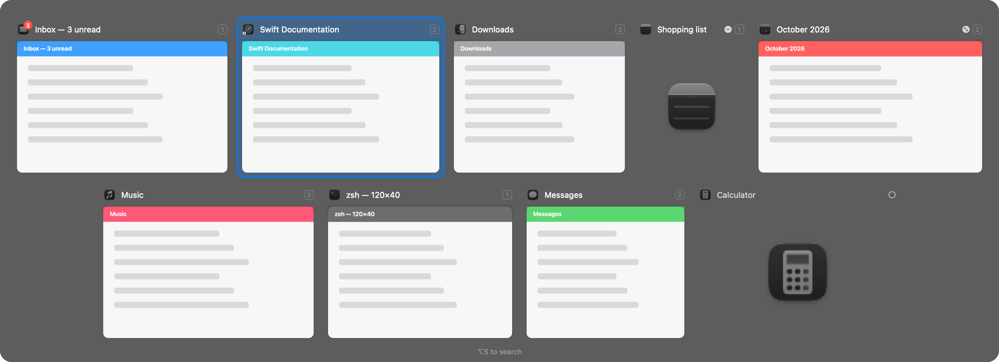
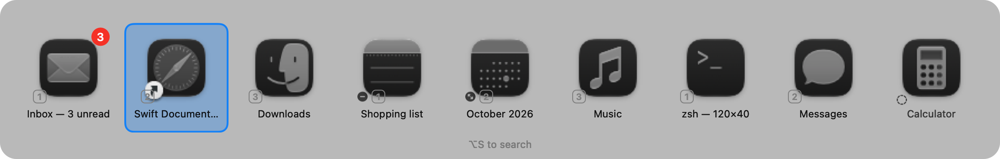
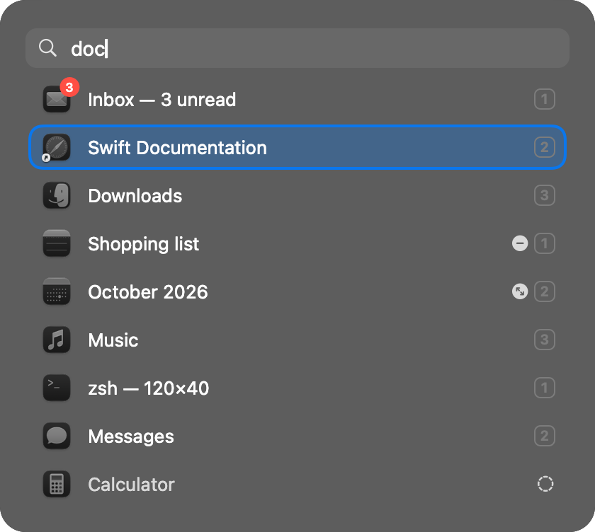
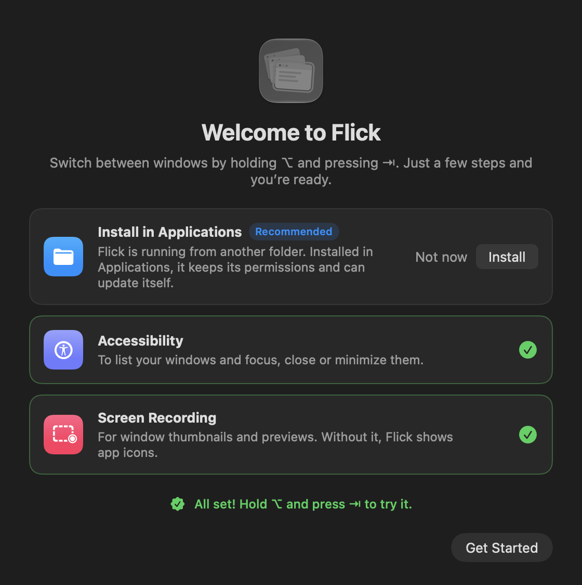

<p align="center">
  
</p>

# Flick

**A fast window switcher for macOS.** Hold <kbd>⌥</kbd> and press <kbd>⇥</kbd> to see every open window — as live
thumbnails, app icons or a list of titles — and jump to any of them, on any Space and any display.

Flick lives in the menu bar, speaks English and French, and is free and open source.

## Download

Get **Flick.dmg** from the [latest release](../../releases/latest), open it and drag Flick onto the Applications
folder. On first launch a welcome window walks you through the two permissions Flick needs (and offers to move it
into Applications if you opened it from somewhere else).

Flick is not notarized: the first time, macOS may refuse to open it. Go to **System Settings › Privacy & Security**
and click **Open Anyway**.

Requires macOS 15 or later.

## Features

**Switching**
- Up to 9 “hold + press” shortcuts, each with its own list of windows: all apps or only the active one, all Spaces
  or only the visible ones, every display or only the current one, minimized / hidden / full-screen windows shown,
  hidden or moved to the end, apps without windows, one window per app, separate tabs.
- Sort by recently used, recently created, alphabetically or by Space.
- ⌘⇥ can be used too: the macOS app switcher is turned off while Flick uses it.
- Trackpad gesture: 3- or 4-finger swipe, horizontal or vertical, with haptic feedback.

**While the switcher is open**
- Focus, cancel, close a window, minimize it, toggle full screen, quit or hide its app — all with one key.
- Fuzzy search across app names and window titles.
- Arrow keys, vim keys (H J K L), mouse hover and click, close / minimize / full-screen buttons on hover.

**Looks**
- Three styles: thumbnails, app icons, titles. Small, medium, large or automatic size.
- Light, dark or system theme; shown on the active screen, the screen with the pointer or the main one.
- Preview of the selected window in place, Space numbers, status icons, Dock badges.
- Adjustable appearance delay: a quick ⌥⇥ switches instantly without flashing the switcher.

**And also**
- Per-app exceptions: hide an app’s windows (or only those whose title matches), or let it keep the shortcuts —
  handy for virtual machines, remote desktops and games.
- Launch at login, choice of menu bar icon, settings export / import, English or French interface.
- Built-in updates from GitHub Releases.
- `flick://show` opens the switcher, `flick://settings` the settings, `flick://update` checks for an update.

<p align="center">
  <br>
  
  
</p>

## Permissions

- **Accessibility** (required): to list windows, focus, close and minimize them, and to read the shortcut keys.
- **Screen Recording** (recommended): for thumbnails and previews. Without it, Flick shows app icons instead.
  Flick only captures windows while the switcher is on screen, so macOS’s capture indicator doesn’t stay up.

## Building

Flick is a Swift package; you need Xcode or the Swift toolchain (Swift 6) on macOS 15 or later.

```bash
swift test                     # unit tests of the switching logic
./Scripts/build-app.sh         # build.noindex/Flick.app, Flick.zip and Flick.dmg (SKIP_DMG=1 to skip the DMG)
.build/debug/Flick --snapshot /tmp/flick   # renders the switcher and settings to PNG files
```

Builds are signed ad hoc with a requirement pinned to the bundle identifier, so macOS keeps the permissions across
rebuilds. Set `CODESIGN_IDENTITY` to sign with your own Developer ID instead.

To publish a version: `Scripts/release.sh 1.0.1 "What changed"` (tags, builds, and uploads `Flick.dmg` and
`Flick.zip` to a GitHub release, where the app’s updater finds it).
